# Awesome-Partner-API-Sharing-Ecosystem

  

# 🌐 Awesome Partner API Sharing & Ecosystem

  
  
  
  
  
  

> 🚀 **A curated directory of top Partner API Sharing and Ecosystem platforms** — spanning enterprise SaaS/Hosted commercial API suites and battle-tested open-source alternatives for publishing, governing, monetizing, and onboarding B2B partners and external developer communities.
> 🌟 *Star this repository to stay updated on the latest open-source API ecosystem innovations!*

---

## 📑 Table of Contents

- [🌐 Sector Overview & Market Dynamics](#-sector-overview--market-dynamics)
- [🟦 SaaS / Hosted Platforms](#-saas--hosted-platforms)
- [🟩 Open-Source Software](#-open-source-software)
  - [1. Traefik](#1-traefik-)
  - [2. Kong Gateway (OSS)](#2-kong-gateway-oss-)
  - [3. Backstage](#3-backstage-)
  - [4. Envoy](#4-envoy-)
  - [5. Swagger UI](#5-swagger-ui-)
  - [6. Apache APISIX](#6-apache-apisix-)
  - [7. Scalar](#7-scalar-)
  - [8. Tyk Gateway (OSS)](#8-tyk-gateway-oss-)
  - [9. Lago](#9-lago-)
  - [10. WSO2 API Manager](#10-wso2-api-manager-)
  - [11. Gravitee API Management](#11-gravitee-api-management-)
- [📊 Comparison Matrix at a Glance](#-comparison-matrix-at-a-glance)
- [📈 Star History](#-star-history)
- [💖 Support & Sponsorship](#-support--sponsorship)
- [🤝 Contributing](#-contributing)
- [📄 License](#-license)

---

## 🌐 Sector Overview & Market Dynamics

The global API management, developer portal, and partner ecosystem market is valued at approximately **$7.7 Billion – $8.2 Billion** (projected to compound at 16%–18% CAGR toward **~$21 Billion+** by 2030). 

The sector is characterized as **moderately concentrated at the top with a fragmented, highly innovative fringe**:
- 🏢 **The Concentrated Core:** Hyperscalers and enterprise mega-vendors (Salesforce/MuleSoft, Google Apigee, Microsoft Azure API Management, IBM API Connect) control large swathes of traditional enterprise accounts via unified cloud bundles and EDI integration capabilities.
- ⚡ **The Competitive Open-Source / Cloud-Native Fringe:** High-velocity open-core platforms (Kong, Tyk, WSO2, Gravitee) and specialized developer portal tools (Backstage, Scalar) prevent monopolistic lock-in by pioneering lightweight, Kubernetes-native microservice routing, interactive documentation, multi-tenancy, and LLM/AI agent gateway mediation.

---

## 🟦 SaaS / Hosted Platforms

Commercial, cloud-hosted Partner API Sharing and Ecosystem platforms sorted by parent company scale (valuation / acquisition price):

| 🏢 Platform | 🎯 Type / Focus | 💰 Valuation / Scale | 🏷️ Starting Price | ⏳ Free Tier &amp; Trial Limits | 🏆 Best For |
|---|---|---|---|---|---|
| **MuleSoft Anypoint Partner Manager** | B2B partner onboarding &amp; EDI/API ecosystem management | **$6.5B** valuation (Salesforce acquisition; ~$300M ARR at buyout) | **$2,000/mo** ($24,000/yr starting package for entry integration tier) | **30-day free trial** (Sales-assisted POC / restricted capacity; no permanent free tier) | Enterprises with complex B2B partner ecosystems needing unified EDI and API onboarding |
| **Kong Konnect** | API management control plane with developer portal &amp; AI gateway | **$2.0B** valuation ($175M Series E; $100M+ ARR) | **$25/mo** (Serverless control plane; Hybrid starts at $200/mo, Cloud at $500/mo) | **30-day free trial** of Konnect Plus (no hard gateway limit, 30-day analytics retention; OSS gateway is free forever) | Organizations wanting a mature, widely deployed gateway with commercial portal &amp; AI governance |
| **RapidAPI Enterprise Hub** | Internal API marketplace &amp; partner sharing hub | **$1.0B** valuation (Series D; acquired by Nokia; ~$24M ARR) | **Custom quote** (Contract-based; minimum 5 team seats required) | **Custom sales-led POC / pilot** (No self-serve or permanent free tier for Enterprise Hub) | Organizations wanting an internal API marketplace with self-service discovery and governance |
| **WSO2 API Manager (Cloud)** | Full-lifecycle API management with developer portal | **$600M+** valuation (Acquired by EQT; ~$100M ARR) | **$119/mo** (Growth plan; covers 10 APIs and up to 10M requests/mo) | **30-day free trial** (Up to 5 APIs, 1M requests/mo, 1 Hybrid Gateway, 1 Developer Portal; core OSS self-hosted is free forever) | Organizations wanting comprehensive API management suite with developer portal and open-core flexibility |
| **Tyk Developer Portal** | API gateway &amp; developer portal management stack | **$140M** valuation ($35M Series B; capital-efficient B-Corp) | **Quote-based commercial tiers** (Historical cloud tiers from ~$600/mo; Professional offers flat data-plane pricing) | **48-hour free trial** of Tyk Cloud (Full access; 14-day trial key for self-managed dashboard &amp; portal; OSS gateway is free forever) | Teams wanting a complete management stack with multi-tenancy and flat data plane pricing options |

---

## 🟩 Open-Source Software

Self-hosted, community-driven Partner API Sharing, Gateway, and Developer Portal platforms. Sorted in **descending order by GitHub star count**:

### 1. Traefik 
- 💻 **Stack:** Go | 📜 **License:** Apache-2.0
- 🔗 **Repository:** [traefik/traefik](https://github.com/traefik/traefik)
- 📌 **Overview:** Traefik is a leading cloud-native HTTP reverse proxy and ingress controller designed for microservices and dynamic container orchestration. For partner API sharing, Traefik natively integrates with Kubernetes, Docker, and Consul, offering automatic service discovery, automatic TLS certificate termination (Let's Encrypt), granular rate limiting, authentication middleware, and traffic routing.
- 🎯 **Best for:** Teams needing dynamic, zero-configuration microservice ingress and routing for external and internal partner traffic.

### 2. Kong Gateway (OSS) 
- 💻 **Stack:** Lua (OpenResty / NGINX) | 📜 **License:** Apache-2.0
- 🔗 **Repository:** [Kong/kong](https://github.com/Kong/kong)
- 📌 **Overview:** Kong Gateway is the world's most widely adopted open-source cloud-native API gateway. It provides sub-millisecond routing, request/response transformation, authentication (OAuth2, Key Auth, HMAC, JWT), traffic control (rate limiting, rate limiting advanced), and observability. It boasts a huge ecosystem of plugins and supports DB-less, PostgreSQL-backed, and hybrid topologies.
- 🎯 **Best for:** High-throughput production gateway runtimes enforcing robust access controls and policies across partner endpoints.

### 3. Backstage 
- 💻 **Stack:** TypeScript / React / Node.js | 📜 **License:** Apache-2.0 (CNCF Incubating)
- 🔗 **Repository:** [backstage/backstage](https://github.com/backstage/backstage)
- 📌 **Overview:** Created by Spotify and donated to the CNCF, Backstage is the industry-standard developer portal platform. It centralizes software catalogs, API specifications (OpenAPI, AsyncAPI, gRPC), documentation, and tech radars in a single unified interface. Teams leverage Backstage to build tailored, branded partner developer portals that integrate with their choice of API gateway.
- 🎯 **Best for:** Platform engineering teams wanting to build a custom, branded developer portal and catalog for internal and external partner onboarding.

### 4. Envoy 
- 💻 **Stack:** C++ | 📜 **License:** Apache-2.0 (CNCF Graduated)
- 🔗 **Repository:** [envoyproxy/envoy](https://github.com/envoyproxy/envoy)
- 📌 **Overview:** Envoy is a high-performance, L7 proxy and communication bus designed for modern service-oriented and cloud-native architectures. With native support for HTTP/2, HTTP/3, and gRPC, Envoy delivers unmatched networking throughput, advanced load balancing, circuit breaking, fault injection, and end-to-end security observability for partner APIs.
- 🎯 **Best for:** Hyper-scale architectures requiring low-latency edge and mesh proxying between partner services and internal clusters.

### 5. Swagger UI 
- 💻 **Stack:** JavaScript / HTML / CSS | 📜 **License:** Apache-2.0
- 🔗 **Repository:** [swagger-api/swagger-ui](https://github.com/swagger-api/swagger-ui)
- 📌 **Overview:** Swagger UI is the ubiquitous open-source documentation interface for OpenAPI specifications. It visualizes and facilitates partner interaction with API resources without having implementation logic in place. It powers the interactive "try-it-out" consoles of countless partner portals across the globe.
- 🎯 **Best for:** Embedding lightweight, standardized interactive API documentation directly into developer portals and partner onboarding docs.

### 6. Apache APISIX 
- 💻 **Stack:** Lua (NGINX + LuaJIT) / etcd | 📜 **License:** Apache-2.0
- 🔗 **Repository:** [apache/apisix](https://github.com/apache/apisix)
- 📌 **Overview:** Apache APISIX is a top-level Apache Software Foundation project providing dynamic, high-performance API orchestration. Built on NGINX and etcd, it eliminates server reloads during configuration updates and features rich out-of-the-box plugins for authentication, rate limiting, canary releases, and AI proxying.
- 🎯 **Best for:** Enterprises demanding ultra-high-performance dynamic routing and cloud-native gateway administration.

### 7. Scalar 
- 💻 **Stack:** TypeScript / Vue / Node.js | 📜 **License:** MIT
- 🔗 **Repository:** [scalar/scalar](https://github.com/scalar/scalar)
- 📌 **Overview:** Scalar is a modern, developer-centric interactive API documentation suite and developer portal engine. It features instant search, built-in API testing clients, code snippets in multiple languages, and a beautiful UI designed to drastically improve partner developer experience (DX) and accelerate time-to-first-request.
- 🎯 **Best for:** Fast-growing startups and enterprises looking to upgrade static documentation into a modern, interactive partner developer portal.

### 8. Tyk Gateway (OSS) 
- 💻 **Stack:** Go | 📜 **License:** MPL-2.0
- 🔗 **Repository:** [TykTechnologies/tyk](https://github.com/TykTechnologies/tyk)
- 📌 **Overview:** Written in Go with zero third-party dependencies, Tyk Gateway is a fast, lightweight open-source API gateway. It natively handles rate limiting, quotas, token management (OAuth2, JWT, Bearer tokens), key management, and API versioning. Its plugin architecture supports languages like Python, JavaScript, and Go.
- 🎯 **Best for:** Engineering teams prioritizing a Go-native, lightweight gateway runtime with flexible plugin extensibility.

### 9. Lago 
- 💻 **Stack:** Ruby on Rails / PostgreSQL / Go | 📜 **License:** AGPL-3.0
- 🔗 **Repository:** [getlago/lago](https://github.com/getlago/lago)
- 📌 **Overview:** Lago is an open-source metering, billing, and monetization engine built for modern SaaS and partner API ecosystems. It meters real-time API call events, handles tiered pricing, subscriptions, overages, and partner revenue sharing, seamlessly integrating with gateways and payment providers like Stripe and Adyen.
- 🎯 **Best for:** Organizations implementing usage-based monetization and tiered metering for external partner APIs.

### 10. WSO2 API Manager 
- 💻 **Stack:** Java | 📜 **License:** Apache-2.0
- 🔗 **Repository:** [wso2/product-apim](https://github.com/wso2/product-apim)
- 📌 **Overview:** WSO2 API Manager is a comprehensive open-source full-lifecycle API platform delivering API design, publishing, gateway routing, traffic control, and a dedicated Developer Portal out of the box. Partners can self-register, discover APIs, subscribe to tiers, generate OAuth2 keys, test endpoints in an interactive console, and track their analytics.
- 🎯 **Best for:** Enterprises requiring an all-in-one open-source package containing both runtime gateway and a customizable partner developer portal.

### 11. Gravitee API Management 
- 💻 **Stack:** Java | 📜 **License:** Apache-2.0
- 🔗 **Repository:** [gravitee-io/gravitee-api-management](https://github.com/gravitee-io/gravitee-api-management)
- 📌 **Overview:** Gravitee is an open-core API management platform uniting synchronous REST/HTTP APIs with asynchronous event-driven architectures (Kafka, MQTT, WebSockets, Webhooks). It includes an open-source Developer Portal for self-service partner onboarding, comprehensive API governance, and flexible policy management.
- 🎯 **Best for:** Organizations needing unified partner API governance across both synchronous REST APIs and real-time streaming/event-driven endpoints.

---

## 📊 Comparison Matrix at a Glance

| 🛠️ Platform | 📜 License | 💻 Core Stack | 📑 Developer Portal | 🤝 Partner Onboarding | ⚡ Gateway Included | 🏠 Self-Hosted | 🎯 Best For |
|---|---|---|---|---|---|---|---|
| **MuleSoft Partner Manager** | Proprietary | Cloud | (Check) | ✅ B2B &amp; EDI | (Anypoint) | ❌ | B2B &amp; EDI partner ecosystems |
| **Kong Konnect** | Proprietary | Cloud | ✅ Enterprise | ✅ Self-service | ✅ Included | ❌ | Mature gateway + AI governance |
| **Traefik** | Apache-2.0 | Go | ❌ (Edge only) | (Via middleware) | ✅ Included | ✅ | Dynamic container &amp; K8s ingress |
| **Kong Gateway (OSS)** | Apache-2.0 | Lua / OpenResty | ❌ (Enterprise) | (Plugin-based) | ✅ Included | ✅ | Ultra-popular, extensible gateway |
| **Backstage** | Apache-2.0 | TypeScript | ✅ Framework | ✅ Self-service | ❌ (External) | ✅ | Extensible custom developer portal |
| **Envoy** | Apache-2.0 | C++ | ❌ (Proxy only) | (External portal) | ✅ Included | ✅ | Ultra-fast L7 edge &amp; mesh proxy |
| **Swagger UI** | Apache-2.0 | JavaScript | ✅ Doc Viewer | ✅ Interactive | ❌ (Viewer only) | ✅ | Standardized OpenAPI documentation |
| **Apache APISIX** | Apache-2.0 | Lua / etcd | ❌ (Gateway only) | (Separate portal) | ✅ Included | ✅ | High-performance dynamic routing |
| **Scalar** | MIT | TypeScript | ✅ Modern Portal | ✅ DX-focused | ❌ (Doc portal) | ✅ | Interactive partner documentation &amp; DX |
| **Tyk Gateway (OSS)** | MPL-2.0 | Go | ✅ Included | ✅ Self-service | ✅ Included | ✅ | Complete Go stack with multi-tenancy |
| **Lago** | AGPL-3.0 | Ruby / Go | ❌ (Billing only) | ✅ Metering/Usage | ❌ (Integrates) | ✅ | API monetization &amp; usage billing |
| **WSO2 API Manager** | Apache-2.0 | Java | ✅ Full-featured | ✅ Self-register | ✅ Included | ✅ | Complete OSS suite (Gateway + Portal) |
| **Gravitee** | Apache-2.0 | Java | ✅ OSS portal | ✅ Self-service | ✅ Included | ✅ | REST &amp; Event-driven API ecosystems |

---

## 📈 Star History

---

## 💖 Support & Sponsorship

Thank you for visiting and supporting this ecosystem initiative! If you find this repository valuable:
- ⭐ **Star this repository** to help others discover it!
- 🍴 **Fork and share** with your network, team, and developer communities.
- ☕ **Support continuous maintenance & open research**: You can sponsor this project or buy a coffee via the [GitHub Sponsor Dashboard](https://github.com/sponsors/ishandutta2007).

Your backing ensures this curated directory stays up-to-date with emerging tools, benchmarks, and architectural patterns.

---

## 🤝 Contributing

Contributions are warmly welcomed! If you know of an outstanding Partner API Sharing, Developer Portal, or Gateway platform that belongs here, please submit a pull request with:

- 🏷️ **Project Name & URL**
- 📝 **Brief Description** (1–2 concise sentences highlighting unique strengths)
- 💻 **Tech Stack & License**
- 💡 **Why it stands out** for partner onboarding and API governance

Please ensure suggested projects are actively maintained (releases within the last 12 months) and respect open community standards.

---

## 📄 License

This collection is released under the [Creative Commons Zero v1.0 Universal (CC0 1.0)](https://creativecommons.org/publicdomain/zero/1.0/) (Public Domain). Each featured project remains licensed under its respective owner's terms.

---

  ⭐ <b>Found this resource useful? Please star the repo to support open-source ecosystem tools!</b> ⭐

